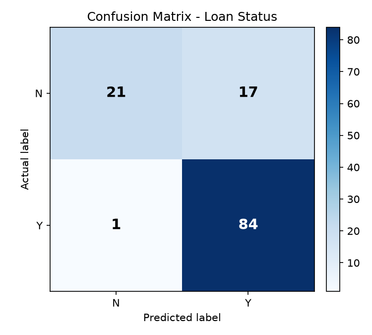

# Loan Classifier

Day 2 exercise — model inference and evaluation on the Loan Prediction dataset,
using a **pretrained** tabular classification model (TabPFN), no training from scratch.

## Dataset

Loan Prediction dataset (Analytics Vidhya / Kaggle):
- `train_u6lujuX_CVtuZ9i.csv` — 614 labeled applicants
- `test_Y3wMUE5_7gLdaTN.csv` — 368 unlabeled applicants

Features: Gender, Married, Dependents, Education, Self_Employed, ApplicantIncome,
CoapplicantIncome, LoanAmount, Loan_Amount_Term, Credit_History, Property_Area.
Label: `Loan_Status` (Y = approved, N = rejected).

## What the script does

`day2_model_inference.py` covers:

1. **Explore the dataset** — shape, dtypes, features/label, class distribution.
2. **Missing values & data prep** — inspects nulls, fills numeric columns with the
   median and categorical columns with the mode, encodes categoricals.
3. **Pretrained model inference** — loads [TabPFN](https://github.com/PriorLabs/TabPFN),
   a transformer pretrained on millions of synthetic tabular datasets. No gradient
   training happens in this script; `fit()` only hands TabPFN the training rows as
   in-context examples, and predictions come with confidence scores
   (`predict_proba`).
4. **Evaluation metrics** — accuracy, precision, recall, full classification report,
   and a confusion matrix (also saved as `confusion_matrix.png`).
5. **Simple CLI interface** — prompts for an applicant's details and prints an
   APPROVED/REJECTED prediction with a confidence percentage.

## Requirements

```
pip install pandas matplotlib scikit-learn tabpfn
```

TabPFN is free for non-commercial/learning use but requires a one-time license
acceptance:

1. Sign in at https://ux.priorlabs.ai
2. Accept the license on the Licenses tab
3. Copy your API key from https://ux.priorlabs.ai/account
4. Set it as an environment variable (never commit it):
   ```
   export TABPFN_TOKEN=your-key        # bash
   $env:TABPFN_TOKEN='your-key'        # PowerShell
   ```

## Run

```
python day2_model_inference.py
```

## Results (validation split, 20% held out)

- Accuracy: **85.4%**
- Precision (approved): **0.832**
- Recall (approved): **0.988**


